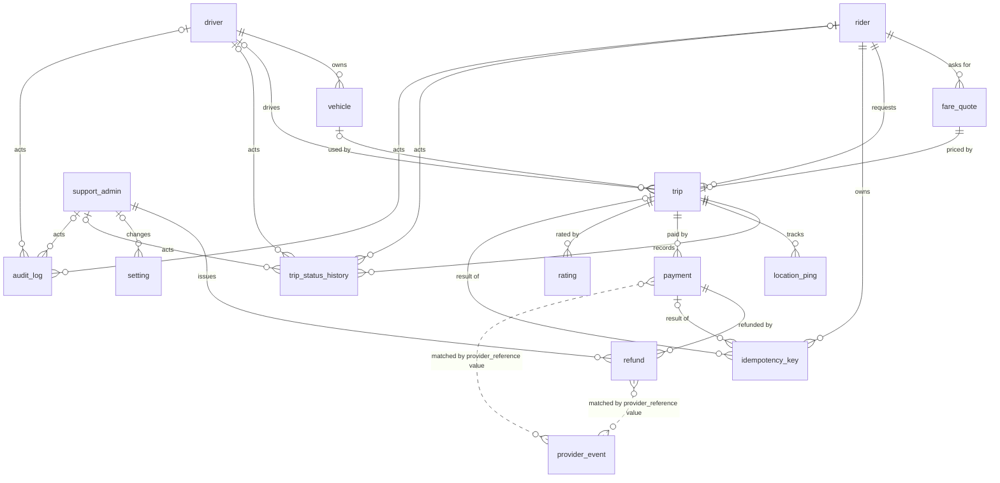

# 02b Relationships

Field names are exactly those in `02_entities.md`. "FK" means foreign key. The FK sits on the "many" side and points at the "one" side. Every FK uses `ON DELETE RESTRICT` (the default `NO ACTION` behaviour is not enough, because I want the error at once). Reason: rows are never hard deleted when they hold personal or financial history (04, question 4, B4, B8), so a delete that would orphan a row should fail loudly.

## Every related pair

| #   | One side                       | Many side            | Cardinality                                                                                                                                                        | FK (direction)                                                              | Serves     |
| --- | ------------------------------ | -------------------- | ------------------------------------------------------------------------------------------------------------------------------------------------------------------ | --------------------------------------------------------------------------- | ---------- |
| R1  | rider                          | fare_quote           | one to many                                                                                                                                                        | fare_quote.rider_id -> rider.id                                             | A1         |
| R2  | rider                          | trip                 | one to many                                                                                                                                                        | trip.rider_id -> rider.id                                                   | A1, B1     |
| R3  | rider                          | idempotency_key      | one to many                                                                                                                                                        | idempotency_key.rider_id -> rider.id                                        | B6         |
| R4  | driver                         | vehicle              | one to many                                                                                                                                                        | vehicle.driver_id -> driver.id                                              | A2         |
| R5  | driver                         | trip                 | one to many (optional: a trip has 0 or 1 driver)                                                                                                                   | trip.driver_id -> driver.id                                                 | A2, B2     |
| R6  | vehicle                        | trip                 | one to many (optional)                                                                                                                                             | (trip.vehicle_id, trip.driver_id) -> (vehicle.id, vehicle.driver_id)        | A2         |
| R7  | fare_quote                     | trip                 | one to zero-or-one                                                                                                                                                 | trip.fare_quote_id -> fare_quote.id, UNIQUE                                 | A1, B6     |
| R8  | trip                           | trip_status_history  | one to many                                                                                                                                                        | trip_status_history.trip_id -> trip.id                                      | B5         |
| R9  | trip                           | location_ping        | one to many                                                                                                                                                        | location_ping.trip_id -> trip.id                                            | A3         |
| R10 | trip                           | payment              | one to many (at most one live fare payment and one live fee payment)                                                                                               | payment.trip_id -> trip.id                                                  | A4, B6     |
| R11 | payment                        | refund               | one to many                                                                                                                                                        | refund.payment_id -> payment.id                                             | B10        |
| R12 | trip                           | rating               | one to many (at most two: one per role)                                                                                                                            | rating.trip_id -> trip.id                                                   | A5, B7     |
| R13 | support_admin                  | refund               | one to many                                                                                                                                                        | refund.created_by_admin_id -> support_admin.id                              | U3         |
| R14 | support_admin                  | setting              | one to many (optional)                                                                                                                                             | setting.updated_by_admin_id -> support_admin.id                             | B9         |
| R15 | rider / driver / support_admin | trip_status_history  | one to many each (exactly one of the three is set, or none for system)                                                                                             | actor_rider_id, actor_driver_id, actor_admin_id                             | B5         |
| R16 | rider / driver / support_admin | audit_log            | one to many each (exactly one set, or none for provider and system)                                                                                                | actor_rider_id, actor_driver_id, actor_admin_id                             | B5         |
| R17 | trip                           | idempotency_key      | one to many (optional)                                                                                                                                             | idempotency_key.trip_id -> trip.id                                          | B6         |
| R18 | payment                        | idempotency_key      | one to many (optional)                                                                                                                                             | idempotency_key.payment_id -> payment.id                                    | B6         |
| R19 | rider                          | trip, via fare_quote | the quote must belong to the trip's rider                                                                                                                          | (trip.fare_quote_id, trip.rider_id) -> (fare_quote.id, fare_quote.rider_id) | A1         |
| R20 | payment or refund              | provider_event       | one to many, **by value only**: `provider_event.provider_reference` equals `payment.provider_reference` or `refund.provider_reference`. No foreign key (see below) | none                                                                        | U4, A4, B6 |

R6 and R19 are composite foreign keys. They make the database refuse a trip that uses another driver's car (A2) or another rider's quote (A1). A plain FK on one column cannot say that. They need two helper unique constraints, `vehicle_id_driver_id_key` on (id, driver_id) and `fare_quote_id_rider_id_key` on (id, rider_id). The composite FK for the vehicle only applies when both columns are filled, so a trip with no driver yet passes. CONFIRMED for the case where `driver_id` and `vehicle_id` are both empty: a requested trip was accepted (rolled back test as `ridehail_app`, `evidence/stage5_export2_composite_fk.txt`). The mixed case, `driver_id` set and `vehicle_id` empty, is not caught by the composite FK (the standard Postgres rule is that a composite FK with an empty column is not checked; INFERRED). Other rules block it: a requested trip row in that state was refused by the check `trip_driver_matches_status` (SQLSTATE 23514, CONFIRMED, same evidence file). The check `trip_snapshots_match_assignment` also covers the case (driver, vehicle and both snapshots must all be filled or all be empty), but that test stopped at the first check and did not show this one on its own. Moving a trip to assigned without a vehicle is refused by the trigger `trip_enforce_transition`: "a vehicle is required to assign a trip" (SQLSTATE RH012, CONFIRMED, test E40 in `evidence/migration_015_error_tests_compare.txt`).

## Many to many

- **Rider and driver** are many to many over time. The `trip` table is the join. It is not a bare join table, because it has its own meaning (status, fare) and its own constraints: `trip_one_active_per_rider` (B1) and `trip_one_active_per_driver` (B2).
- **Trip and rating role** is the other join. `rating` has the unique constraint `rating_one_per_role_per_trip` (B7), so a trip holds at most one rider rating and one driver rating.
- **Driver and vehicle** is one to many, not many to many (assumption 3: a car belongs to one driver). If two drivers share a car later, this becomes a join table.

## Three links that are NOT foreign keys, and why

- `audit_log.entity_id` points at different tables depending on `entity_type`. A foreign key cannot do that. Integrity here is by the trigger that writes the row (INFERRED).
- `status_transition_rule` is not linked to `trip.status` or `payment.status`. A trigger reads the rule rows. A foreign key cannot check a pair of values (from and to).
- `provider_event.provider_reference` is not linked to `payment` or `refund` by a foreign key; this is the same by-value link as **R20** in the table above. The same column can point at either table, and a message about a reference we do not know must still be stored so support can see it (U4, B6). The match is done by value in the callback handler (application code, INFERRED).

## Diagram (Mermaid)



The two dotted lines at the end are non-identifying "by value" links, not foreign keys. This diagram was checked by reading only and was not rendered.

## Diagram (plain ASCII)

Each line is "parent (1) -> child (N)". `0..1` means the link is optional. The child holds the foreign key.

```
rider (1)
  |-- N fare_quote (rider_id)
  |        `-- 0..1 trip (fare_quote_id, unique: a quote starts at most one trip)
  |-- N trip (rider_id)
  `-- N idempotency_key (rider_id)

driver (1)
  |-- N vehicle (driver_id)
  |-- N trip (driver_id, optional until assigned)
  `-- trip(vehicle_id, driver_id) -> vehicle(id, driver_id)   [a trip's car must be its driver's car]

trip (1)
  |-- N trip_status_history (trip_id)
  |-- N location_ping (trip_id)
  |-- N payment (trip_id)
  |        `-- N refund (payment_id)
  |                 `-- created_by_admin_id -> support_admin
  |-- N rating (trip_id)         [at most 2: one per rater_role]
  `-- N idempotency_key (trip_id, optional)   [payment_id, optional, works the same way]

support_admin (1)
  |-- N refund (created_by_admin_id)
  `-- N setting (updated_by_admin_id, optional)

rider, driver, support_admin: each is also the optional actor (exactly one set,
or none for system/provider) in trip_status_history and audit_log.

provider_event (no parent): provider_reference matches payment.provider_reference
or refund.provider_reference by value only. Not a foreign key.

Not foreign keys: audit_log.entity_id (points at many tables),
status_transition_rule (read by triggers, not linked),
provider_event.provider_reference (matched by value).
```
