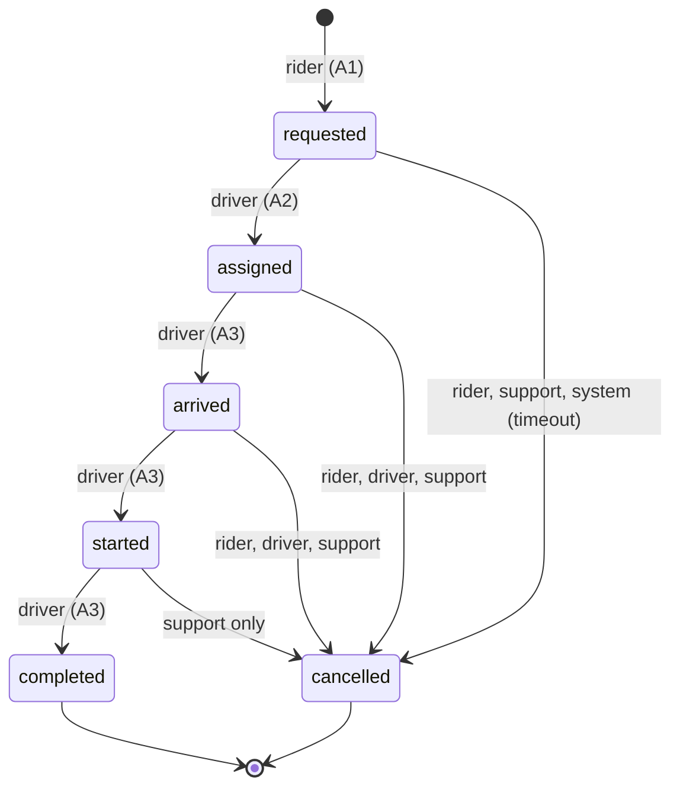
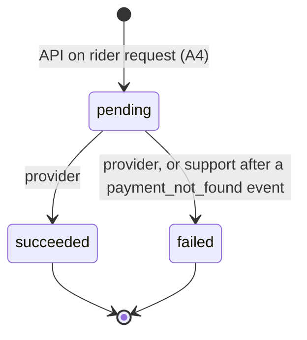

# 03 State Machine

Status words and field names match `02_entities.md`. Requirement IDs come from `01_requirements.md`.

## 1. Trip statuses

requested, assigned, arrived, started, completed, cancelled. **Active** (B0) means requested, assigned, arrived or started. **Terminal** means no further status change: completed and cancelled.

## 2. Allowed trip transitions

Each row below is also one row in `status_transition_rule` with `entity = 'trip'` (14 rows). The "who" column is the `actor_role`.

| #   | From      | To        | Who may do it          | Serves     | Meaning                                                                                                                                                                                                                                                                                       |
| --- | --------- | --------- | ---------------------- | ---------- | --------------------------------------------------------------------------------------------------------------------------------------------------------------------------------------------------------------------------------------------------------------------------------------------- |
| T0  | (new)     | requested | rider                  | A1, B1, B5 | The rider requests a trip. A new trip may only start as requested.                                                                                                                                                                                                                            |
| T1  | requested | assigned  | driver                 | A2, B2     | A driver accepts. `driver_id` and `vehicle_id` are set in the same update.                                                                                                                                                                                                                    |
| T2  | assigned  | arrived   | driver                 | A3         | The driver reached the pickup.                                                                                                                                                                                                                                                                |
| T3  | arrived   | started   | driver                 | A3         | The rider is in the car. `started_at` is set.                                                                                                                                                                                                                                                 |
| T4  | started   | completed | driver                 | A3, B4     | The drive is over. `completed_at`, `fare_amount_minor`, `fare_currency` and `distance_m` are set.                                                                                                                                                                                             |
| T5  | requested | cancelled | rider, support         | B9         | No driver yet, so no fee. A driver cannot cancel here, because a requested trip has no driver (assumption 4).                                                                                                                                                                                 |
| T6  | assigned  | cancelled | rider, driver, support | B9         | Fee only if the rider cancels.                                                                                                                                                                                                                                                                |
| T7  | arrived   | cancelled | rider, driver, support | B9         | Fee only if the rider cancels.                                                                                                                                                                                                                                                                |
| T8  | started   | cancelled | support only           | B9         | Rider and driver cannot cancel once the ride has started.                                                                                                                                                                                                                                     |
| T9  | requested | cancelled | system                 | B9, B1     | Timeout: no driver accepted within `request_timeout_seconds` (placeholder 600, needs owner approval). No fee. It frees the rider to request again (B1). The timer itself is application code (a scheduled job). The database only allows the move for actor `system` and only from requested. |

Row count: T1 to T4 give 4 rows (one actor each), T5 gives 2, T6 gives 3, T7 gives 3, T8 gives 1 and T9 gives 1, so 4 + 2 + 3 + 3 + 1 + 1 = 14 rows. T0 is not a row, because a new trip has no "from" status. It is enforced by the insert check. (Before this fix the count was 13.)

**Cancellation fee** (B9, Q2). When status becomes cancelled, the database copies `cancellation_fee_minor` from the setting of the same name, but only when `cancelled_by_role = 'rider'` and the trip was already assigned or arrived. In every other cancellation, including the system timeout T9, the fee is 0 (assumption 6, decision 5). **Open (Q6):** if an assigned driver never arrives and the rider cancels, this rule still charges the rider. The owner must decide before launch. My recommendation: no fee when the driver is more than a stated number of minutes late, with that number held in a setting (the name `driver_late_minutes_no_fee` is reserved, no value is chosen). It is not built or tested here, and the fee rule above is unchanged. The copy is a HISTORY snapshot, so a later change to the setting never changes an old trip.

## 3. Forbidden trip transitions

A careless design would allow every row below. Each one is blocked. Rows marked "tested" were run in a rolled back transaction (section 7). In the last column, "step N" is the cut down copy of section 7. "Yes, built database" names a test raised again on the finished database (the evidence file is named in the cell). "Cut down copy only" means that no built database test of that case was found.

| #   | Forbidden move                                                                            | Why it is dangerous                                                                                                                              | Blocked by                                                                                                                                                                                                                                                      | Tested                                                                                                                                                                                                  |
| --- | ----------------------------------------------------------------------------------------- | ------------------------------------------------------------------------------------------------------------------------------------------------ | --------------------------------------------------------------------------------------------------------------------------------------------------------------------------------------------------------------------------------------------------------------- | ------------------------------------------------------------------------------------------------------------------------------------------------------------------------------------------------------- |
| F1  | completed -> started (re-open)                                                            | Changes a finished, possibly paid, trip (B4)                                                                                                     | terminal freeze in trigger `trip_enforce_transition`                                                                                                                                                                                                            | yes, step 10; yes, built database, E06 (`migration_015_error_tests_compare.txt`)                                                                                                                        |
| F2  | cancelled -> assigned (zombie trip)                                                       | A cancelled trip comes back and gets a driver                                                                                                    | terminal freeze in trigger `trip_enforce_transition`                                                                                                                                                                                                            | yes, step 14; cut down copy only                                                                                                                                                                        |
| F3  | A driver accepts a trip the rider cancelled a second ago (race)                           | Driver is sent to a rider who is gone. **Not obvious**: both requests are individually "valid"                                                   | the app's update says `WHERE status = 'requested'`, and the trigger refuses cancelled -> assigned                                                                                                                                                               | yes, step 14 (cut down copy, the trigger refuses cancelled to assigned); yes, built database, F3 race test (guard returns UPDATE 0, and without the guard RH005), `evidence\stage5_export4_f3_race.txt` |
| F4  | support cancels a completed trip                                                          | Cancelling after payment hides the money trail (B4). Support gets no special power here                                                          | terminal freeze                                                                                                                                                                                                                                                 | yes, step 11; cut down copy only                                                                                                                                                                        |
| F5  | requested -> started (or any skipped step)                                                | Skips the driver arriving, and the history looks wrong (B5)                                                                                      | no matching row in `status_transition_rule`                                                                                                                                                                                                                     | yes, step 16; yes, built database, E05 (requested -> started by a driver, RH008; `migration_015_error_tests_compare.txt`)                                                                               |
| F6  | started -> arrived (going backwards)                                                      | Rewrites the story of the trip                                                                                                                   | no matching row                                                                                                                                                                                                                                                 | covered by the same rule as F5, which ran on the built database as E05; F6 itself was not run on its own                                                                                                |
| F7  | assigned -> requested (a driver "un-assigns")                                             | The history would look as if the trip was never taken, and a driver could dodge a cancellation. A driver who cannot do the trip must cancel (T6) | no matching row                                                                                                                                                                                                                                                 | covered by the same rule as F5, which ran on the built database as E05; F7 itself was not run on its own                                                                                                |
| F8  | rider or driver cancels a started trip                                                    | Only support may (B9)                                                                                                                            | no row for those roles                                                                                                                                                                                                                                          | covered by the same rule as F5; yes, built database, E05b (rider cancels a started trip, RH008; `migration_015_error_tests_compare.txt`)                                                                |
| F9  | driver B moves driver A's trip to arrived                                                 | A stranger changes someone else's trip. **Not obvious**: the move itself is legal                                                                | actor check in trigger: `driver_id` must equal the actor's id                                                                                                                                                                                                   | yes, step 7; yes, built database, E38 (`migration_015_error_tests_compare.txt`) and X2 (`proofs_rejected_and_extra.txt`)                                                                                |
| F10 | driver B takes a trip driver A already holds, **without changing status**                 | **Not obvious**: status stays "assigned", so the transition table is never consulted. This is the double-accept bug                              | `driver_id` cannot change once set, in `trip_enforce_transition`                                                                                                                                                                                                | yes, step 6; yes, built database, E39 (RH006; `migration_015_error_tests_compare.txt`)                                                                                                                  |
| F11 | a new trip is inserted already as assigned or completed                                   | Skips A1 and A2                                                                                                                                  | insert check in `trip_enforce_transition`                                                                                                                                                                                                                       | yes, step 3; yes, built database, U-RH002 (insert as assigned, RH002; `untested_rh_codes_proofs.txt`); an insert as completed was not run on its own                                                    |
| F12 | rider marks the trip arrived                                                              | A rider cannot be the driver (A3)                                                                                                                | no row for that role                                                                                                                                                                                                                                            | yes, step 8; cut down copy only                                                                                                                                                                         |
| F13 | edit `fare_amount_minor` of a completed trip                                              | B4                                                                                                                                               | terminal freeze                                                                                                                                                                                                                                                 | yes, step 12; yes, built database, X1 (`proofs_rejected_and_extra.txt`)                                                                                                                                 |
| F14 | change `rider_id` or `fare_quote_id` of any trip                                          | Moves a trip to another account                                                                                                                  | the immutability check in the same trigger: the rule "these columns may not change in this move" (SQLSTATE RH015, migration 015 lines 489 to 494). It is a different statement from the driver_id check of F10 (SQLSTATE RH006, migration 015 lines 438 to 440) | not tested for rider_id or fare_quote_id on either copy; the same check ran on the built database for another column, pickup_address, as E41 (RH015; `migration_015_error_tests_compare.txt`)           |
| F15 | delete a trip row                                                                         | Loses history (B4, B5)                                                                                                                           | trigger `trip_block_delete`                                                                                                                                                                                                                                     | cut down copy: not tested; yes, built database, U-RH016a (app role refused by privilege) and U-RH016b (dev login stopped by the trigger, RH016), `untested_rh_codes_proofs.txt`                         |
| F16 | a driver has a second active trip                                                         | B2                                                                                                                                               | partial unique index `trip_one_active_per_driver`                                                                                                                                                                                                               | yes, step 5; yes, built database, E08 (23505; `migration_015_error_tests_compare.txt`)                                                                                                                  |
| F17 | a rider has a second active trip                                                          | B1                                                                                                                                               | partial unique index `trip_one_active_per_rider`                                                                                                                                                                                                                | yes, step 2; yes, built database, E01 (23505; `migration_015_error_tests_compare.txt`)                                                                                                                  |
| F18 | the system cancels an assigned, arrived or started trip (a timeout job that is too eager) | A rider or driver is cut off mid-ride, or a fee-free cancel hides a driver's no-show                                                             | no row for actor `system` except requested -> cancelled (T9)                                                                                                                                                                                                    | not tested (same lookup as F5), on either copy                                                                                                                                                          |
| F19 | the application inserts a history row or an audit row itself (a false record)             | B5 would be meaningless: anyone with the app role could write the story                                                                          | `ridehail_app` has no INSERT on `trip_status_history` or `audit_log` (migration 010); only the `ridehail_writer` functions write them                                                                                                                           | yes, built database, as ridehail_app, E36 (`migration_015_error_tests_compare.txt`) and `proofs_migration_010.txt`: "permission denied for table trip_status_history" and "... audit_log"               |

Step 15 of the test also showed the other direction: once a trip is cancelled or completed, the rider may request again (the partial index only covers active statuses).

## 4. Payment statuses and transitions

Statuses: pending, succeeded, failed. Succeeded and failed are terminal. Rows in `status_transition_rule` with `entity = 'payment'`: **three** (P1, P2, P3). History of the count: three in Stage 2; two after the system-timeout move was removed (our own clock must never declare a payment failed when the provider may still have taken the money); three again now, with the new support move P3, which is not clock based.

| #   | From    | To        | Who                            | Serves | Meaning                                                                                                                                                                                                                                                                                                                                                                                                                                                                             |
| --- | ------- | --------- | ------------------------------ | ------ | ----------------------------------------------------------------------------------------------------------------------------------------------------------------------------------------------------------------------------------------------------------------------------------------------------------------------------------------------------------------------------------------------------------------------------------------------------------------------------------- |
| P0  | (new)   | pending   | the API on the rider's request | A4, B6 | A payment may only be created as pending, for a completed trip's fare or a cancelled trip's fee, with the exact amount owed                                                                                                                                                                                                                                                                                                                                                         |
| P1  | pending | succeeded | provider                       | A4     | Provider confirms. `provider_reference` and `paid_at` must be set                                                                                                                                                                                                                                                                                                                                                                                                                   |
| P2  | pending | failed    | provider                       | A4     | Provider says declined. `failure_reason` must be set                                                                                                                                                                                                                                                                                                                                                                                                                                |
| P3  | pending | failed    | support                        | A4, B6 | **Only if** a `provider_event` of type `payment_not_found` exists for this payment's `provider_reference`, was received after the payment was created, **and is not older than the latest provider event of any type for that reference** (a later `payment_succeeded` or `payment_failed` cancels the proof). `failure_reason` must be set. This is the way out of a stuck payment (section 4b). It is a person's decision after the provider said it has no record, not a timeout |

(The Stage 2 move named P3, pending -> failed by actor `system`, was removed and is not this one. The new P3 is by actor `support` and has a condition.)

A payment stays **pending until the provider answers**. It is never failed by our own clock. While a payment is pending, the one-live-payment rule (`payment_one_live_per_purpose`) keeps the rider from being charged twice, so a stuck pending payment blocks a retry. Section 4b is the way out.

**Why P3 needs a trigger.** The condition looks at another table (`provider_event`). A check constraint sees only the payment row, so it cannot do this. The payment trigger `payment_enforce_rules` looks up the event. The reference must match, the type must be `payment_not_found`, `received_at` must not be before the payment's `created_at` (so an old answer about a different attempt cannot be reused), and `received_at` must be at least as late as the newest event of any type for the same reference (so a "succeeded" that arrives after "no record" takes the proof away). The ordering needs a distinct `received_at` per event, which is why that column defaults to `clock_timestamp()` (02, provider_event). CONFIRMED on the real database: refused without proof, accepted with proof, refused when superseded by a later `payment_succeeded` (Stage 2 proofs X5a to X5c, evidence `proofs_rejected_and_extra.txt`).

Forbidden payment moves:

| #    | Forbidden move                                                                                                                                                                                        | Why                                                                                                                                                                        | Blocked by                                                           |
| ---- | ----------------------------------------------------------------------------------------------------------------------------------------------------------------------------------------------------- | -------------------------------------------------------------------------------------------------------------------------------------------------------------------------- | -------------------------------------------------------------------- |
| PF1  | succeeded -> failed                                                                                                                                                                                   | A late "failed" message must not erase money we hold                                                                                                                       | terminal freeze in trigger `payment_enforce_rules`                   |
| PF2  | failed -> succeeded                                                                                                                                                                                   | **Not obvious.** The rider retried and a new payment exists. Flipping the old one could double charge (B6). A late success on a failed payment is handled as in section 4a | terminal freeze                                                      |
| PF3  | support or rider marks a payment succeeded                                                                                                                                                            | Only the provider can confirm money                                                                                                                                        | no row for those roles                                               |
| PF4  | a payment created already as succeeded                                                                                                                                                                | Skips the provider                                                                                                                                                         | insert check in `payment_enforce_rules`                              |
| PF5  | a fare payment for a trip that is not completed                                                                                                                                                       | Charging before the ride ends                                                                                                                                              | trigger `payment_enforce_rules` (looks at `trip.status`)             |
| PF6  | an amount different from the trip's `fare_amount_minor` or `cancellation_fee_minor`                                                                                                                   | Wrong charge (B3)                                                                                                                                                          | trigger `payment_enforce_rules`                                      |
| PF7  | a second live payment (pending or succeeded) for the same trip and purpose                                                                                                                            | Double charge (A4, B6)                                                                                                                                                     | partial unique index `payment_one_live_per_purpose` (tested P2, P4)  |
| PF8  | a refund on a payment that is not succeeded, or above the amount                                                                                                                                      | B10                                                                                                                                                                        | trigger `refund_enforce_total` (tested R2, R4, R5)                   |
| PF9  | our own system marks a pending payment failed (the removed Stage 2 move)                                                                                                                              | The provider may still have taken the money                                                                                                                                | no row for actor `system` in the payment rules (tested, S9)          |
| PF10 | support fails a pending payment with no `payment_not_found` event for it, or with an event for another reference, of another type, older than the payment, or superseded by a later event of any type | Support could write off a payment the provider actually took, with nothing to show why                                                                                     | the lookup inside trigger `payment_enforce_rules` (tested, S1 to S4) |
| PF11 | support fails a succeeded payment, even when a `payment_not_found` event exists                                                                                                                       | Succeeded is terminal, money was taken                                                                                                                                     | terminal freeze (tested, S7)                                         |
| PF12 | support marks a pending payment succeeded                                                                                                                                                             | Only the provider can confirm money                                                                                                                                        | no row for support to succeeded (tested, S8)                         |

Test ids in brackets (P2, P4, R2, R4, R5 and similar) refer to the payment test in the report, not to the payment moves P0 to P3 above. Step ids S1 to S11 belong to the stuck-payment test in section 4b.

Every payment status change is also written to `audit_log` by trigger `payment_write_audit`, so B5 covers payments (decision 6).

## 4a. When the provider reports a result that conflicts with ours

The provider can repeat a message, or send one that contradicts a payment we already settled (for example "succeeded" for a payment we marked failed, or "failed" for one that succeeded). Handling, in one database transaction, in the callback handler (application code):

1. Insert a `provider_event` row. The unique constraint `provider_event_provider_event_id_key` decides what happens next.
   - **Same `provider_event_id` seen before:** the insert is refused (or does nothing with `ON CONFLICT DO NOTHING`). Nothing else changes. The handler answers the provider "received". The first row is the proof that the message was already seen. A repeat leaves no second row (decision 13 asks whether you want repeats counted). CONFIRMED by test (output below).
   - **New `provider_event_id`:** the row is stored with `processed_at` and `outcome` empty, then the handler looks up the payment by `provider_reference` and compares.
2. If the message agrees with a legal move (pending -> succeeded, or pending -> failed), apply it with actor `provider`. Outcome `applied`.
3. If the payment already has that result, outcome `ignored_duplicate`. No change.
4. If the message **conflicts** (the payment is failed and the provider says succeeded, or it is succeeded and the provider says failed, or the reference is unknown): the payment row is **not changed** (it is terminal, PF1 and PF2). The event row gets outcome `needs_support`, and an `audit_log` row (action `provider_conflict`) is written by the trigger `provider_event_write_audit`, so a person sees it. The row's `entity_type` is `payment` when a payment has that reference, `refund` when a refund has it, and **`provider_event`** (the event's own id) when nobody knows the reference. The third case was added in Stage 3, because `audit_log.entity_id` must be filled and an unknown reference has nothing else to cite.
5. **Support then refunds through the provider by hand.** Take the common case: the payment was failed, the rider retried, the retry succeeded, and the old payment now reports succeeded. The rider has paid twice. Support refunds the surplus in the provider's dashboard.

**The `refund` table only covers succeeded payments** (trigger `refund_enforce_total`, B10). In step 5 the old payment row is failed in our database, so there is no succeeded payment to attach a refund row to. That manual refund is therefore **not** a row in `refund`. Its trace is the `provider_event` rows (including a `refund_succeeded` event if the provider sends one) and the `audit_log` note.

**KNOWN GAP (decided for this assignment, decision 14).** I do **not** build a money record for a manual refund of a failed payment. Nobody can query "how much did we refund by hand" from the `refund` table, and B10 is not checked for these refunds. The only trace is `provider_event` plus `audit_log`. This is also listed under non goals in 01 and under known gaps in 05, so the write-up states it as a limit and not as a surprise.

## 4b. A stuck pending payment: the way out, with no clock-based failure

**What "stuck" means.** The payment is pending and the provider has not told us the result. By `payment_one_live_per_purpose` the rider cannot start another payment for the same fare, so the rider is blocked (A4, B6).

**Reconciliation job (application code).** Setting `payment_reconcile_after_seconds` (placeholder 900, **needs owner approval**). Any payment that has been pending longer than that is checked with the provider by its `provider_reference`. The job does one of these, in one database transaction:

| The provider says                        | The job does                                                                                                                                                                             | Result                                            |
| ---------------------------------------- | ---------------------------------------------------------------------------------------------------------------------------------------------------------------------------------------- | ------------------------------------------------- |
| succeeded                                | inserts a `provider_event` (type `payment_succeeded`), moves the payment pending -> succeeded as actor `provider` (P1), sets `paid_at`                                                   | the rider's trip is paid; outcome `applied`       |
| failed                                   | inserts a `provider_event` (type `payment_failed`), moves pending -> failed as actor `provider` (P2) with the provider's reason                                                          | the rider can retry; outcome `applied`            |
| "no record of this payment"              | inserts a `provider_event` of type `payment_not_found` with outcome `needs_support`. The trigger `provider_event_write_audit` writes an `audit_log` note. **The payment stays pending.** | support is alerted; nothing is decided by a clock |
| no answer (provider down, network error) | does nothing and tries again at the next run                                                                                                                                             | the payment stays pending                         |

The job never fails a payment by itself, not even on "no record". Reason: "no record" can be a provider delay or a mismatch of references, and writing off a payment the provider later settles would charge the rider twice (B6). A person looks first.

**Support step (move P3).** Support checks the provider's dashboard. If the provider really has no payment, support fails the pending payment (actor `support`, with a reason). The database allows it only because a `payment_not_found` event exists, is newer than the payment, and has not been superseded by a later event of any type (PF10). If a "succeeded" message arrived after the "no record" answer, the database refuses and support must treat the payment as paid. The rider is then free to pay again.

**If the provider later says succeeded for a payment support failed:** that is the conflict case in section 4a (PF2): the payment row does not change, the message is stored as `needs_support`, and support refunds by hand at the provider. This path ends in the KNOWN GAP above.

**Test of P3 (CONFIRMED, rolled back transaction, cut-down copy of payment, provider_event and the rule table, same trigger idea; the test ran as the dev superuser, but constraints and triggers fire for it too):**

```
S1  support fails pending PRV-A, no event at all                      -> ERROR: support may fail a pending payment only after a payment_not_found event for this reference
S2  event exists but for another reference (PRV-B)                    -> same ERROR
S3  an event of the wrong type (payment_failed) exists for PRV-A      -> same ERROR
S4  a payment_not_found event for PRV-C received before the payment    -> same ERROR
    was created
S5  a proper payment_not_found event for PRV-A; support fails PRV-A    -> accepted
    with a reason
S6  proper event for PRV-D but no failure_reason                       -> ERROR: new row for relation "payment" violates check constraint "payment_check"
S7  provider marks PRV-E succeeded, then support tries to fail it      -> ERROR: payment is succeeded (terminal): status cannot change
    although a not_found event exists
S8  support marks pending PRV-F succeeded                              -> ERROR: illegal payment transition pending -> succeeded by support
S9  system (our clock) fails pending PRV-F                             -> ERROR: illegal payment transition pending -> failed by system
S10 provider fails pending PRV-F, no not_found event                   -> accepted (P2 is unaffected)
S11 provider flips failed PRV-A to succeeded                           -> ERROR: payment is failed (terminal): status cannot change
final statuses: PRV-A failed, PRV-B pending, PRV-C pending, PRV-D pending, PRV-E succeeded, PRV-F failed
after ROLLBACK: 0 tables/indexes, 0 functions, 0 extra roles
```

Not tested: the real `payment_enforce_rules` trigger with its other duties (insert checks, exact amount), two sessions at once, and the reconciliation job (it does not exist).

**Test of the unique behaviour (CONFIRMED, rolled back transaction, cut-down copy of the table with the same unique and check constraints):**

```
E1 first callback evt-1                         -> INSERT 0 1
E2 same callback again, plain INSERT            -> ERROR: duplicate key value violates unique constraint "provider_event_provider_event_id_key"
E3 same callback, ON CONFLICT DO NOTHING        -> INSERT 0 0   (no error)
E3b rows in table after both repeats            -> 1
E4 new event id, same payment reference         -> INSERT 0 1   (a contradicting later message is allowed in)
E5 mark it needs_support                        -> UPDATE 1
E6 outcome without processed_at                 -> ERROR: ... violates check constraint "provider_event_check1"
E7 amount without currency                      -> ERROR: ... violates check constraint "provider_event_check"
E8 unknown event type                           -> ERROR: ... violates check constraint "provider_event_event_type_check"
after ROLLBACK: 0 tables, 0 functions, 0 extra roles
```

Not tested: two callbacks arriving at the same moment (the unique index should make one wait and then fail, INFERRED), and the `provider_event_guard` and `provider_event_write_audit` triggers.

## 5. What enforces each rule, and why

A **check constraint** sees only the one row being written. It cannot know the old value, and it cannot look at another table. So it is right for "this row is internally valid". A **trigger** can read the old row (`OLD`), other rows and other tables. So anything about _moving from_ a state or _comparing with_ another table needs a trigger. A **partial unique index** is the right tool for "at most one row of this kind", because the database checks it atomically even when two requests arrive at once. **Application code** is the weakest place, because a second program, a script or a typing mistake can skip it. I use it only where the database cannot know the answer (who the caller really is).

| Rule                                                                                                                                             | Enforcer                                                                                                                                                                                                                                                                                                                                                                          | Why this one                                                                                                                                                                                                                                                                                                                                                                                                                                                                                                                                                                                                                                                                                                                                                                                                                                                                                                                                                                                                                                                                                                         |
| ------------------------------------------------------------------------------------------------------------------------------------------------ | --------------------------------------------------------------------------------------------------------------------------------------------------------------------------------------------------------------------------------------------------------------------------------------------------------------------------------------------------------------------------------- | -------------------------------------------------------------------------------------------------------------------------------------------------------------------------------------------------------------------------------------------------------------------------------------------------------------------------------------------------------------------------------------------------------------------------------------------------------------------------------------------------------------------------------------------------------------------------------------------------------------------------------------------------------------------------------------------------------------------------------------------------------------------------------------------------------------------------------------------------------------------------------------------------------------------------------------------------------------------------------------------------------------------------------------------------------------------------------------------------------------------- |
| Legal trip transitions (B5, B9)                                                                                                                  | table `status_transition_rule` + trigger `trip_enforce_transition`                                                                                                                                                                                                                                                                                                                | A check cannot see the old status. The rows are data, so a person can read and review them.                                                                                                                                                                                                                                                                                                                                                                                                                                                                                                                                                                                                                                                                                                                                                                                                                                                                                                                                                                                                                          |
| A new trip starts as requested (A1)                                                                                                              | trigger `trip_enforce_transition` (insert branch)                                                                                                                                                                                                                                                                                                                                 | A check cannot tell an insert from an update.                                                                                                                                                                                                                                                                                                                                                                                                                                                                                                                                                                                                                                                                                                                                                                                                                                                                                                                                                                                                                                                                        |
| Terminal trips are frozen; only `updated_at` may change (B4). The one exception is blanking five text columns for erasure (B8), see the next row | trigger `trip_enforce_transition` plus `trip_block_delete`                                                                                                                                                                                                                                                                                                                        | Needs OLD and NEW side by side.                                                                                                                                                                                                                                                                                                                                                                                                                                                                                                                                                                                                                                                                                                                                                                                                                                                                                                                                                                                                                                                                                      |
| Erasure of personal text on terminal rows (B8, decision 1)                                                                                       | the SECURITY DEFINER functions `erase_rider` and `erase_driver`, owned by the role `ridehail_erasure_owner`. The freeze trigger lets `pickup_address`, `dropoff_address`, `driver_name_snapshot`, `vehicle_plate_snapshot` (on trip) and `comment` (on rating, trigger `rating_block_change`) change only when `current_user` is `ridehail_erasure_owner`, and only those columns | Replaces the earlier `app.erasure` flag, which any code with database access could have set. Now the right is tied to a database role. `ridehail_erasure_owner` is `NOLOGIN` (nobody can connect as it), is not a superuser, and the app role `ridehail_app` may only `EXECUTE` the functions. Inside a SECURITY DEFINER function `current_user` is the function's owner, so the trigger sees the owner, not the app. CONFIRMED by test 2 in the report. The functions also refuse to erase a person who has an active trip (tested for riders). **Two layers:** for `rating.comment` the first layer is privilege, because `ridehail_app` has no UPDATE on `rating` at all ("permission denied for table rating", CONFIRMED), and the trigger `rating_block_change` is the second layer for any role that does have UPDATE. For the five text columns the owner role's exact column grants are in migrations 008 and 009 (listed in 04 question 4).                                                                                                                                                                 |
| Unmatched request expires (B9, B1)                                                                                                               | rule row T9 (actor `system`) in `status_transition_rule` + trigger `trip_enforce_transition`; the timer is a scheduled job (application code)                                                                                                                                                                                                                                     | The database cannot run a clock by itself. It can only say who may make the move.                                                                                                                                                                                                                                                                                                                                                                                                                                                                                                                                                                                                                                                                                                                                                                                                                                                                                                                                                                                                                                    |
| Support fails a stuck payment only with proof (A4, B6)                                                                                           | rule row P3 (actor `support`) in `status_transition_rule` + trigger `payment_enforce_rules`, which looks up a `payment_not_found` row in `provider_event`                                                                                                                                                                                                                         | The condition reads another table, so a check cannot do it. CONFIRMED by the test in section 4b.                                                                                                                                                                                                                                                                                                                                                                                                                                                                                                                                                                                                                                                                                                                                                                                                                                                                                                                                                                                                                     |
| Repeated or conflicting provider message (U4, B6)                                                                                                | unique constraint `provider_event_provider_event_id_key`; triggers `provider_event_guard` and `provider_event_write_audit`; the handler in section 4a is application code                                                                                                                                                                                                         | The unique constraint makes a repeat a no-op. The handler decides outcomes, which needs knowledge of the payment.                                                                                                                                                                                                                                                                                                                                                                                                                                                                                                                                                                                                                                                                                                                                                                                                                                                                                                                                                                                                    |
| Driver set once, rider and quote never change (A2, F10)                                                                                          | trigger `trip_enforce_transition`                                                                                                                                                                                                                                                                                                                                                 | Needs OLD.                                                                                                                                                                                                                                                                                                                                                                                                                                                                                                                                                                                                                                                                                                                                                                                                                                                                                                                                                                                                                                                                                                           |
| Right person for each move (F9, F12)                                                                                                             | trigger compares the claimed actor id with `rider_id` or `driver_id`, and application code authenticates the caller                                                                                                                                                                                                                                                               | The database cannot know who is really calling. It can only compare the identity the app claims through `app.actor_role` and `app.actor_id`. The app must set these from the logged-in user.                                                                                                                                                                                                                                                                                                                                                                                                                                                                                                                                                                                                                                                                                                                                                                                                                                                                                                                         |
| One active trip per rider, per driver (B0, B1, B2)                                                                                               | partial unique indexes `trip_one_active_per_rider`, `trip_one_active_per_driver`                                                                                                                                                                                                                                                                                                  | Atomic under concurrency.                                                                                                                                                                                                                                                                                                                                                                                                                                                                                                                                                                                                                                                                                                                                                                                                                                                                                                                                                                                                                                                                                            |
| Every status change recorded (B5)                                                                                                                | trigger `trip_write_history`, and `payment_write_audit` for payments. Both functions are `SECURITY DEFINER`, owned by the role `ridehail_writer`; `ridehail_app` has no INSERT on `trip_status_history` or `audit_log` (migration 010)                                                                                                                                            | If the app wrote history, one forgotten call would leave a gap, and an application with INSERT could also write a false row. Now it cannot: a direct INSERT is refused by privilege (CONFIRMED, "permission denied for table trip_status_history" and "... audit_log"). The functions still record the claimed actor, because `app.actor_role` and `app.actor_id` are session settings and are unchanged inside a SECURITY DEFINER function (CONFIRMED for rider, driver, support and system actors). **Also:** `EXECUTE` on these four functions is revoked from PUBLIC (migration 012; a trip move, a payment change, a setting change and a provider conflict were all re-proved as `ridehail_app` afterwards), and every function ends its search_path with `pg_temp` (migration 013, next row). **What remains:** a superuser can still bypass all of this, and the actor name is stated by the application, so a compromised `ridehail_app` could still claim to be another actor (CONFIRMED with a real login role: it can call `add_support_note`, and is refused only because it claimed no support actor). |
| Search path of every function (B4, B5, B9, A4)                                                                                                   | `search_path = pg_catalog, public, pg_temp` on all 18 functions (migration 013)                                                                                                                                                                                                                                                                                                   | PostgreSQL looks in the temporary schema first for tables unless `pg_temp` is named in the path, and `ridehail_app` may create temp tables. Before the fix, CONFIRMED as `ridehail_app`: a temp `audit_log` swallowed a payment audit row, a temp `trip_status_history` swallowed a history row, and a temp `status_transition_rule` let a forbidden skipped move (F5) through. After the fix all three attacks fail. An attacker-owned schema on the session path never worked against the SECURITY DEFINER writers. Migration 014 then revoked the TEMP privilege from PUBLIC on the database, so `ridehail_app` cannot create the temp table at all (CONFIRMED: "permission denied to create temporary tables in database"; the attacks E1, E2, E4 stop at that statement, E3 still has no effect). Limits: only three table names were attacked, and `pg_hba` trusts loopback and the local socket inside the container.                                                                                                                                                                                         |
| Dispute notes (U3, docs 01)                                                                                                                      | function `add_support_note` (SECURITY DEFINER, owner `ridehail_writer`), executable by `ridehail_app` only, and only for a claimed `support` actor                                                                                                                                                                                                                                | Without it, revoking INSERT on `audit_log` would leave support unable to write a note (CONFIRMED: refused for a rider actor, refused for a role with no grant).                                                                                                                                                                                                                                                                                                                                                                                                                                                                                                                                                                                                                                                                                                                                                                                                                                                                                                                                                      |
| Timeline order (B5, A3)                                                                                                                          | column `trip_status_history.seq` (identity) and index `trip_status_history_trip_seq_idx`                                                                                                                                                                                                                                                                                          | `created_at` is the same for every move in one transaction. `seq` is assigned by the database at insert time. CONFIRMED: ordering four same-instant rows by `created_at` then `id` scrambled the chain, ordering by `seq` kept it right.                                                                                                                                                                                                                                                                                                                                                                                                                                                                                                                                                                                                                                                                                                                                                                                                                                                                             |
| Trip row looks right for its status (B3, B4)                                                                                                     | check constraints `trip_driver_matches_status`, `trip_completed_has_facts`, `trip_cancelled_has_facts`, and others in 04, question 6                                                                                                                                                                                                                                              | Single-row facts.                                                                                                                                                                                                                                                                                                                                                                                                                                                                                                                                                                                                                                                                                                                                                                                                                                                                                                                                                                                                                                                                                                    |
| Payment lifecycle (A4, B6)                                                                                                                       | table `status_transition_rule` + trigger `payment_enforce_rules` + partial unique index `payment_one_live_per_purpose`                                                                                                                                                                                                                                                            | Same reasons as the trip.                                                                                                                                                                                                                                                                                                                                                                                                                                                                                                                                                                                                                                                                                                                                                                                                                                                                                                                                                                                                                                                                                            |
| Refund total (B10)                                                                                                                               | trigger `refund_enforce_total` with `SELECT ... FOR UPDATE` on the payment row                                                                                                                                                                                                                                                                                                    | A check cannot add up other rows. The row lock makes two refunds at the same moment wait for each other. The lock is INFERRED from Postgres behaviour. I did not run two sessions at once.                                                                                                                                                                                                                                                                                                                                                                                                                                                                                                                                                                                                                                                                                                                                                                                                                                                                                                                           |
| Retry safety (B6)                                                                                                                                | unique constraint `idem_one_key_per_rider_action` + application code that returns the stored response                                                                                                                                                                                                                                                                             | The unique constraint stops the second insert. Only code can send back the saved answer.                                                                                                                                                                                                                                                                                                                                                                                                                                                                                                                                                                                                                                                                                                                                                                                                                                                                                                                                                                                                                             |

## 5a. The trip, payment and setting triggers as built (Stage 3)

The docs above said "a trigger enforces this". These are the details that were open when the triggers were written. The database is the truth.

**trip_enforce_transition** (before insert or update on `trip`)

- Insert: status must be `requested`; no start, end or cancel time may be supplied; the claimed actor must be the rider (`app.actor_role = rider` and `app.actor_id` equal to `rider_id`); the fare quote, if it exists, must not be expired.
- A terminal row (completed or cancelled): only `updated_at` may change. The one exception is `current_user = ridehail_erasure_owner` changing the five erasure columns (B4, B8).
- Other rows: `driver_id` is set once. A status change needs a row in `status_transition_rule` for the claimed actor. A rider actor must be the trip's rider, a driver actor must be the trip's driver, a support actor must have an id.
- **The trigger writes the derived columns, not the application:** the driver and vehicle snapshots at assignment; `started_at`, `completed_at`, `cancelled_at` (all `now()`); `cancelled_by_role` (the claimed actor); `cancellation_fee_minor` (the setting `cancellation_fee_minor` only when a rider cancels from assigned or arrived, otherwise 0) and `cancellation_fee_currency` (NGN). The application supplies only the fare, its currency and the distance when it completes a trip, and the vehicle when it assigns one.
- **Only the columns that belong to a move may change** in that move (for example, the move to `started` may change `status`, `updated_at` and `started_at` only). A status-unchanged update may change `updated_at` only.

**payment_enforce_rules** (before insert or update on `payment`)

- Insert: status must be `pending`; the claimed actor must be the trip's rider; a `fare` payment needs a completed trip and exactly `fare_amount_minor`; a `cancellation_fee` payment needs a cancelled trip with a fee above 0 and exactly that fee.
- A terminal row (succeeded, failed): only `updated_at` may change.
- A pending row: a status change needs a rule row for the claimed actor. A support actor needs an id and the P3 proof (4b). Only the columns of the move may change (`paid_at` for succeeded, `failure_reason` for failed).

**setting_write_audit**: after insert or update on `setting`, writes an `audit_log` row (`setting_change`, with the key, old and new value in `details`). Only a claimed `support` actor with an id may insert or change a setting.

**payment_write_audit**: after an update that changes `payment.status`, writes an `audit_log` row (`status_change`, from and to in `details`) with the claimed actor. No row is written when the payment is created.

All four history and audit writers (`trip_write_history`, `setting_write_audit`, `payment_write_audit`, `provider_event_write_audit`) run as `ridehail_writer` (see section 5).

## 6. Diagrams

### Mermaid, trip



### Mermaid, payment



Both Mermaid diagrams were checked by reading only. They were not rendered, because no renderer is installed.

### ASCII, trip

```
 (new, by rider, A1)
        |
        v
 [requested] --driver (A2)--> [assigned] --driver--> [arrived] --driver--> [started] --driver--> [[completed]]
      |                           |                     |                      |
      | rider, support,           | rider, driver,      | rider, driver,       | support only
      | system (timeout)          | support             | support              |
      +---------------------------+---------------------+----------------------+
                                  |
                                  v
                            [[cancelled]]

 [[double brackets]] = terminal, no way out (B4).
 Every arrow not drawn is forbidden (F1 to F19).
```

### ASCII, payment

```
   API (A4) --> [pending] --(provider)--> [[succeeded]]
                    |
                    +--(provider)--> [[failed]]
                    +--(support, only if a payment_not_found event exists)--> [[failed]]
   No arrows leave the double-bracket states.
```

## 7. Test of the trigger idea (CONFIRMED)

I built a cut-down copy of the trip table, the rule table and the trigger inside `BEGIN ... ROLLBACK`, with the same logic as `trip_enforce_transition` and the two partial indexes. After the rollback I counted tables and functions: 0 tables, 0 functions (CONFIRMED). Results by step, as printed by Postgres (messages are quoted; PowerShell showed errors out of order, so I matched them by message text):

| Step | What was tried                                  | Result                                                                                   |
| ---- | ----------------------------------------------- | ---------------------------------------------------------------------------------------- |
| 1    | rider1 requests trip                            | accepted                                                                                 |
| 2    | rider1 requests a second active trip            | `duplicate key value violates unique constraint "one_rider"`                             |
| 3    | insert a trip already completed                 | `new trip must start as requested`                                                       |
| 4    | driver1 accepts trip 1                          | accepted                                                                                 |
| 5    | driver1 accepts a second trip while busy        | `duplicate key value violates unique constraint "one_driver"`                            |
| 6    | driver2 takes trip 1, status unchanged          | `driver_id cannot change once set`                                                       |
| 7    | driver2 moves trip 1 to arrived                 | `actor is not this trip's driver`                                                        |
| 8    | rider1 moves own trip to arrived                | `illegal transition assigned -> arrived by rider`                                        |
| 9    | driver1: arrived, started, completed            | all three accepted                                                                       |
| 10   | completed -> started                            | `trip is completed (terminal): only updated_at may change`                               |
| 11   | support cancels completed trip                  | same terminal message                                                                    |
| 12   | change fare of completed trip                   | same terminal message                                                                    |
| 13   | change only `updated_at` of completed trip      | accepted                                                                                 |
| 14   | rider2 cancels trip 2, then driver2 accepts it  | cancel accepted; accept gives `trip is cancelled (terminal): only updated_at may change` |
| 15   | rider1 requests again after finishing           | accepted (the partial index freed the slot)                                              |
| 16   | driver takes requested trip straight to started | `illegal transition requested -> started by driver`                                      |

The history table received 9 rows from the trigger: 4 creation rows (from_status empty), 4 moves of trip 1 (assigned, arrived, started, completed) and 1 cancellation, each with the right actor role. Not tested: two sessions racing at the same moment, the `trip_block_delete` trigger, the cancellation fee copy, and the snapshot copy. The new system move T9 was not run (it uses the same lookup as the tested moves). The erasure functions and roles have their own test (test 2 in the report; summary in 04, question 4).

## 8. Scheduled jobs the design depends on

Two rules need a clock or a poller, and the database cannot run one by itself. Both jobs are **application code**. They are not designed or built here. This section says what the design needs from them. No interval below is an owner-chosen number: each interval is a setting; Stage 4 applied placeholders of 60 and 300 seconds that the owner must confirm (`09_open_items.md`).

|                   | Request timeout job                                                                                                                                             | Payment reconciliation job                                                                                                                                                                                                                                                                                                                                   |
| ----------------- | --------------------------------------------------------------------------------------------------------------------------------------------------------------- | ------------------------------------------------------------------------------------------------------------------------------------------------------------------------------------------------------------------------------------------------------------------------------------------------------------------------------------------------------------ |
| Serves            | T9 (B9, B1)                                                                                                                                                     | section 4b (A4, B6)                                                                                                                                                                                                                                                                                                                                          |
| What it does      | finds trips with status requested older than `request_timeout_seconds` (placeholder 600, needs owner approval) and cancels each one with actor `system`, no fee | finds payments pending longer than `payment_reconcile_after_seconds` (placeholder 900, needs owner approval) and checks each with the provider, then acts as in the table in 4b                                                                                                                                                                              |
| Who runs it       | the application's scheduler (any single worker; the owner picks the tool in Stage 3)                                                                            | the same                                                                                                                                                                                                                                                                                                                                                     |
| How often         | every `request_timeout_check_interval_seconds` (setting; placeholder 60 seconds applied in Stage 4, needs the owner)                                            | every `payment_reconcile_check_interval_seconds` (setting; placeholder 300 seconds applied in Stage 4, needs the owner)                                                                                                                                                                                                                                      |
| Connects as       | role `ridehail_app`, **never** the dev superuser `ridehail`                                                                                                     | role `ridehail_app`, **never** the dev superuser `ridehail`                                                                                                                                                                                                                                                                                                  |
| If it is down     | A requested trip nobody accepts is **not** cancelled. The rider stays blocked by B1 (one active trip) until they cancel it themselves. Nothing else breaks      | Payments **stay pending**. Riders with a stuck payment stay blocked from paying again, and support is not alerted to "no record" answers. Nothing is failed by mistake                                                                                                                                                                                       |
| Safe to run twice | yes: the update says `WHERE status = 'requested'` and a cancelled trip is terminal, so a second run does nothing (INFERRED, T9 untested)                        | yes: a second check of the same payment produces a repeated or new provider_event, which the unique constraint on `provider_event_id` handles (INFERRED); the job should build its own event id from the payment id and the provider's answer id when the provider gives one, otherwise from the time of the run, so a reused id cannot hide a second answer |

Why `ridehail_app` and not the superuser: a superuser skips privilege checks and can switch triggers off, so a job running as `ridehail` could do things that production never allows, and tests run that way would pass for the wrong reason (04, question 6, Stage 3 rule). A weakness that remains: the actor name (`system`, `provider`, `support`) is stated by the application. A compromised application role could state any of them. The database checks that the stated actor may make that move. It cannot prove who the actor really is (INFERRED, already noted in section 5).

If either job is down for long, the owner should be told. A health signal for the jobs (last successful run time) is not designed here.
