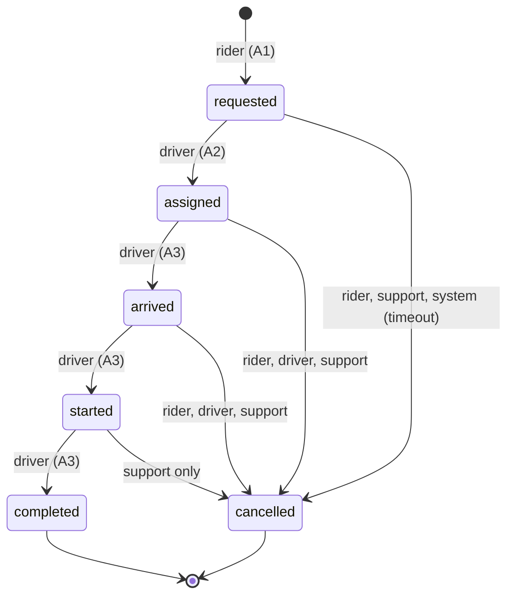

# 14 Post: the bug the state machine cannot see

## The surprise

When I built the trip state machine, I thought it would catch every illegal move. It does not. There is one move in the fault list, F10, that the state machine never even looks at, and it is the one a real rider is most likely to feel: two drivers both accept the same trip.

Here is why it slips past. A normal illegal move changes the status, for example a rider trying to move a trip from `completed` back to `started`. The trigger compares the old status with the new status, looks up the pair in the `status_transition_rule` table, sees no row for that actor, and refuses. That works.

But the double accept changes the status from `assigned` to `assigned`. It only swaps the `driver_id` from driver A to driver B. The transition table has a row for `requested` to `assigned` by a driver, and the pair on both sides of this move is `assigned` to `assigned`, so the lookup finds nothing to complain about. Status is unchanged, so the status based check is blind. One trip ends up with A believing they have it and B holding it.

## The fix

The guard lives in the same trigger, `trip_enforce_transition`, but on a different condition. It checks the columns, not the status: `driver_id` cannot change once it has been set. On the second accept the update touches `driver_id` on a row where it is already filled, so the trigger raises SQLSTATE RH006 and the second driver gets nothing. The rule is "these columns are decided once", which is a column rule and not a status rule.

This is the lesson of the whole exercise: a state machine catches moves between named states, but a move that keeps the same name is invisible to it, and you still have to guard the columns yourself. The evidence is in `03_state_machine.md` line 45 (F10) and the test is E39 in `migration_015_error_tests_compare.txt`.

## The trip state machine

The diagram below is Mermaid text. It was checked by reading, and it has not been rendered, because no Mermaid renderer is installed in this container.

The same machine in words. A trip starts as `requested` when the rider asks for it. A driver picks it up and it becomes `assigned`; then `arrived`, then `started`, then `completed`. From `requested`, the rider, support or the timeout can cancel it. From `assigned` or `arrived`, the rider, the driver or support can cancel it. From `started`, only support can cancel it, because the ride is under way. `completed` and `cancelled` are the end, with no way back out. Every arrow not drawn is forbidden.

## Why this is worth a post

The double accept is a good example of a rule that hides between two layers. Read the state machine alone and you would certify the design as safe. Only when you ask "what column changed, and was the status allowed to stay the same?" do you find the hole. If I were teaching this, F10 would be the worked example: the illegal move that does not move.
